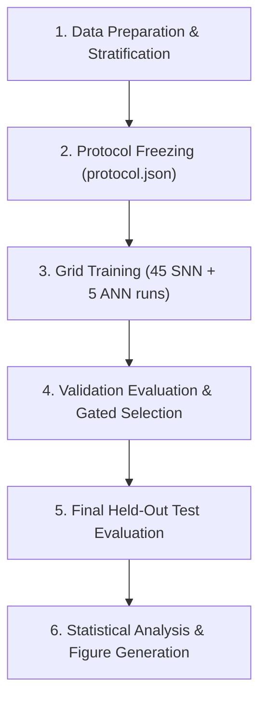

# Research Implementation & Execution Plan

This document outlines the software architecture, execution milestones, verification checkpoints, and analysis pipeline for the Spiking Neural Network accuracy–activity trade-off study.

---

## 1. System Architecture and Module Responsibilities

The codebase is structured into modular components with strict separation between modeling, data handling, experiment tracking, and statistical analysis:

| Component | Path | Responsibility |
|---|---|---|
| **Configuration** | `src/surj_snn/config.py` | Validated experiment schemas, parameter grids, cryptographic digest computation. |
| **Data Engine** | `src/surj_snn/data.py` | Stratified dataset partitioning, fast index batching, exact Bernoulli Poisson encoding, threaded prefetching. |
| **Models** | `src/surj_snn/models.py` | Custom LIF cell with subtractive reset, layer-major feed-forward SNN, ReLU reference ANN. |
| **Metrics** | `src/surj_snn/metrics.py` | Effective SynOps calculation, ANN MAC accounting, classification metrics (accuracy, macro-F1), memory footprint. |
| **Experiment Runner** | `src/surj_snn/experiment.py` | Training loops, checkpointing, validation-gated testing, protocol freezing, grid sharding. |
| **Statistical Analysis** | `src/surj_snn/analysis.py` | Nested seed aggregation, paired effect estimation, 95% confidence intervals, automated publication figures. |
| **CLI Dispatcher** | `src/surj_snn/cli.py` | Unified command-line interface for individual scripts. |

---

## 2. Research Workflow Milestones



### Milestone 1: Environment Setup & Automated Verification
- Verify the test suite (28 tests covering LIF dynamics, exact reset gradients, surrogate slope, SynOps accounting, and deterministic sharding).
- Run the synthetic smoke workflow (`smoke.json` / `smoke_cuda.json`) to confirm end-to-end file generation, protocol locking, and figure generation.

### Milestone 2: Dataset Preparation & Protocol Freezing
- Download Fashion-MNIST (or MNIST) and construct deterministic stratified splits (54k train, 6k validation, 10k test).
- Compute cryptographic digests (`manifest.json` and `study.json`).
- Freeze the experimental protocol (`protocol.json`). Once frozen, any alteration to config or code prevents test-set evaluation without starting a new study.

### Milestone 3: Grid Execution
- Train the full factorial design: $T \in \{8, 16, 32\}$, $\lambda \in \{0.0, 0.1, 1.0\}$, across 5 random seeds ($N=50$ total training runs).
- For local multi-core CPUs or cloud GPUs (e.g. Kaggle T4), execute runs sequentially or in parallel using `scripts/run_parallel.py`.

### Milestone 4: Validation Evaluation & Strategy Selection
- Evaluate all trained models on the validation partition across 3 independent input encoding seeds.
- Compute validation-based optimal interventions:
  - Best regularized model ($\lambda^*$) within $\le 1.0\text{ pp}$ accuracy drop.
  - Best threshold multiplier ($\alpha^*$) within $\le 1.0\text{ pp}$ accuracy drop.
- Lock candidate decisions in `selection.json`.

### Milestone 5: Held-Out Test Evaluation & Statistical Synthesis
- Evaluate all conditions on the 10,000-sample test set across 3 novel test encoding seeds.
- Compute seed-level paired difference metrics ($\Delta \text{Acc}$, $\% \Delta \text{SynOps}$) with 95% Student's $t$ confidence intervals.
- Generate final analysis tables (`summary.csv`, `primary_paired_effects.csv`) and publication figures (PDF and PNG).

---

## 3. Command Reference

### Local CPU Execution (Windows / PowerShell)
```powershell
# 1. Run automated unit and science test suite
.\run.ps1 -Action check

# 2. Run synthetic smoke test
.\run.ps1 -Action smoke

# 3. Run small MNIST pilot (3 epochs)
.\run.ps1 -Action pilot

# 4. Run main Fashion-MNIST study
.\run.ps1 -Action main-train
.\run.ps1 -Action main-validate
.\run.ps1 -Action main-test
```

### Direct Python / Linux / GPU Execution
```bash
# Data preparation & protocol lock
python scripts/prepare_data.py --config configs/main_cuda.json --download
python scripts/freeze_protocol.py --config configs/main_cuda.json

# Parallel grid execution (3 workers on GPU)
python scripts/run_parallel.py --config configs/main_cuda.json --stage train --workers 3
python scripts/run_parallel.py --config configs/main_cuda.json --stage validate --workers 3

# Validation analysis & strategy locking
python scripts/analyze.py --config configs/main_cuda.json --split validation
python scripts/select.py --config configs/main_cuda.json

# Final test evaluation & synthesis
python scripts/run_parallel.py --config configs/main_cuda.json --stage test --workers 3
python scripts/analyze.py --config configs/main_cuda.json --split test
```
